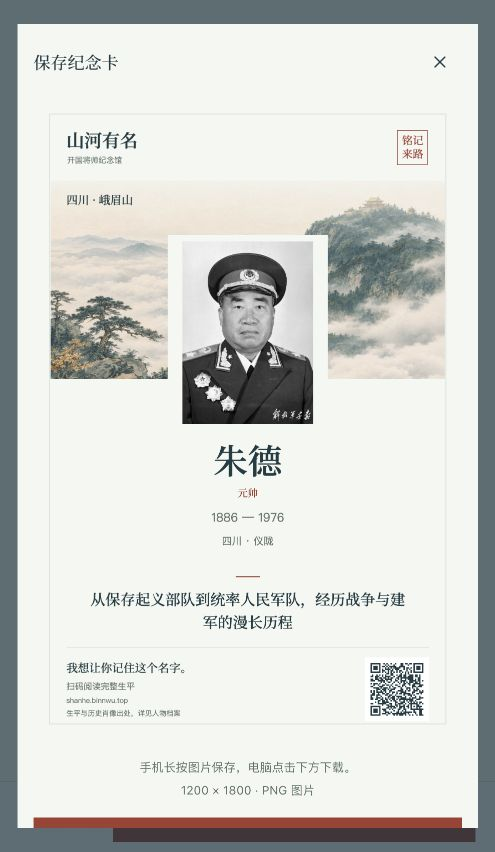

# 纪念卡二维码验收

日期：2026-11-17。范围：本地H5构建；桌面Codex内置浏览器和独立静态成图校验。

## 结果

“家乡山河”和“素笺肖像”的右下角加入真实人物档案二维码；左侧保留纪念句、扫码提示、域名和资料说明。二维码、肖像、正文一起绘入1200×1800 PNG，预览和保存无需各自拼装。朱德的扫码内容为 `https://shanhe.binnwu.top/#/pages/person/index?id=zhude`；所有卡片使用正式HTTPS地址，本地生成时也一致。

二维码使用 `qrcode-generator@2.0.4`，Q级纠错，保留四模块纯白静区，每模块4个PNG像素。运行时只在本地Canvas绘制，无第三方二维码图片服务。原MIT许可随仓库保留在 [许可文件](../../../public/licenses/qrcode-generator-MIT.txt)。

## 自动检查

完整 `npm run check` 退出码0，包含类型、事实快照离线复现、数据、功能、设计、12项目录回归、15项生平回归、1609张肖像×2样式及6个极端比例、3228个卡片文字布局和H5生产构建。

生产绘图函数经Skia栅格化，再使用独立的 `jsqr@1.4.0` 解码，断言精确人物地址：

| 范围 | 检查 | 结果 |
| --- | --- | --- |
| 全部1614人 | 600px宽成图的二维码落款像素 | 1614个地址通过 |
| 9人×2样式 | 完整1200×1800 PNG | 18张通过 |
| 相同18个构图 | 缩小至800×1200、JPEG质量75后解码 | 18张通过 |

代表人物包含徐向前（当前最长链接、较密二维码）、马尔果夫·伊斯哈科夫（长姓名）、于侠（缺肖像）、于权伸（地域待核实）、舒行（生卒待核实），以及粟裕、李贞、孔庆德、倪志亮。报告见 [二维码报告](../../../data/design/card-qr-report.json) 和 [文字布局报告](../../../data/design/card-layout-report.json)。

## 真实页面

通过CUA访问 `http://127.0.0.1:5173` 已构建页面，实际切换样式、打开及关闭保存弹层。三例均确认预览图片src、保存弹层图片src与下载href的完整data URL相同。实际PNG另用jsQR验证原图和缩小压缩JPEG，共6次通过；尺寸均1200×1800。原始文件和SHA-256见 [浏览器成图报告](../../../data/testing/card-qr-browser-2026-11-17.json)，原始观察见 [browser-observations.json](browser-observations.json)。

| 人物与样式 | 实际CSS视口 | 证据 |
| --- | --- | --- |
| 朱德／家乡山河 | 495×852 | [页面](zhude-landscape-page.jpg)、[保存弹层](zhude-save.jpg)、[原PNG](zhude-landscape.png) |
| 朱德／素笺肖像 | 495×852 | [页面](zhude-portrait-page.jpg)、[原PNG](zhude-portrait.png) |
| 徐向前／家乡山河 | 405×852 | [页面](xuxiangqian-405-page.jpg)、[保存弹层](xuxiangqian-save.jpg)、[原PNG](xuxiangqian-landscape.png) |

请求375×812视口时工具实际给出405×852，按实际尺寸记账；朱德默认页面和徐向前窄屏检查无横向溢出。默认布局保持样式、预览、保存的顺序，较密二维码未遮挡纪念文案。临时视口已恢复，页面回到朱德家乡山河。

未点击下载验证文件落盘，未访问线上扫码目标，未做手机相机、微信识码、真实转发压缩、其他浏览器引擎或生产部署。静态解码与软件JPEG压缩不替代这些项目。功能代码及证据本轮保留在工作区，提交与发布以Git和部署记录为准。

