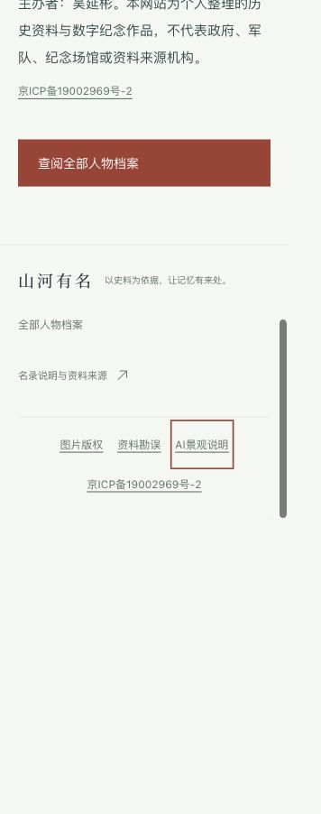
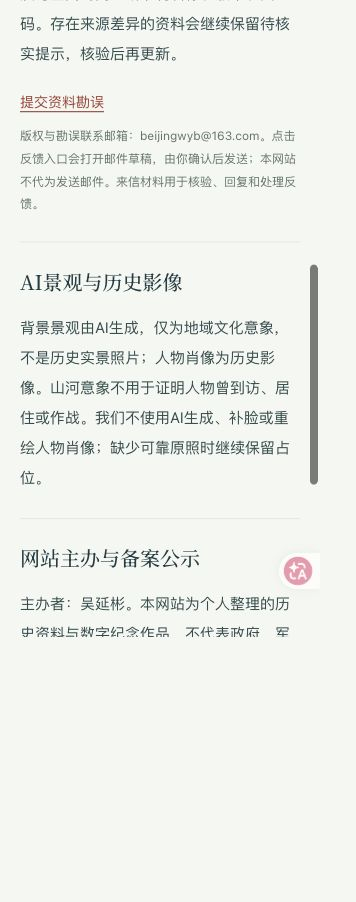
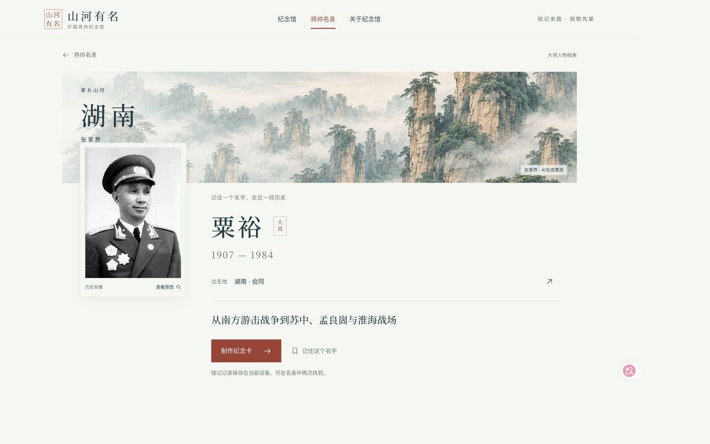
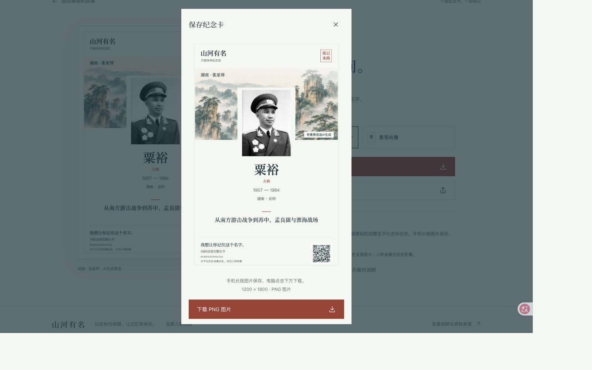
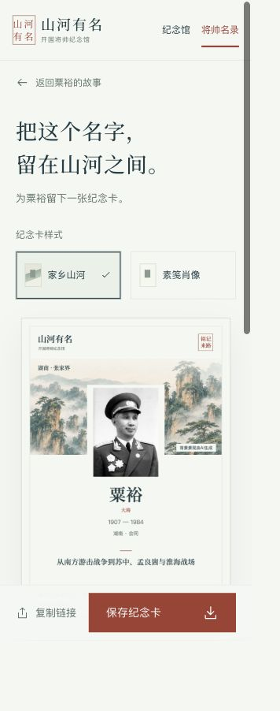
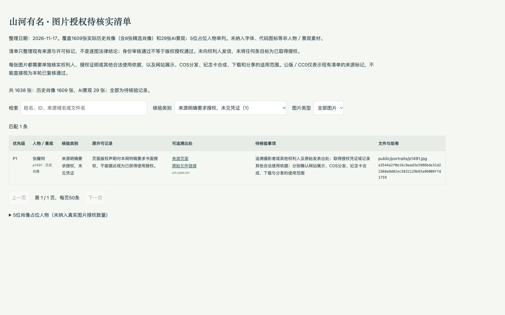

# 公示、反馈与AI景观标识验收

日期：2026-11-17。对象：本地生产构建，Chrome浏览器；本轮未提交、推送或部署。新增公示来自腾讯云已核对的ICP备案及主办者、用户指定邮箱；公安查询遇到人机验证后按用户要求停止，使用已有信息。

## 已验证

- 完整 `npm run check` 通过。合规校验覆盖3228份具名邮件草稿、1638张图片清单；景观卡显式标签与实际构图一致，原有全量人像、卡片布局、二维码及SEO检查通过。
- 另解析1619份最终HTML：每页页脚ICP备案查询与3类说明链接完整；说明页4个章节及3个邮箱入口保留在静态正文中。人物事实及两份肖像来源清单的基线SHA-256一致。
- Chrome实际CSS视口320×812：版权／勘误锚点到达相应章节，邮箱与说明可换行，页脚无横向溢出；Shift+Tab能看到链接焦点。AI景观说明区与纪念卡手机布局已查看。
- Chrome实际CSS视口1440×900：首页及粟裕人物景观提示、具名反馈链接，卡片样式及保存弹层；两张1200×1800实际成图的预览、弹层与下载href相同。景观PNG可见AI标签，素笺没有错误景观标签；两个PNG独立解码均为 `https://shanhe.binnwu.top/people/suyu/`。
- 授权清单：朱德搜索1条、CC0分类1条、AI景观29条、未知词0条且分页禁用、全部记录第2/33页50条、P1张耀祠1条。原文件与哈希已分行。清单不自动加载外部来源图片。

浏览器视口覆盖由读数确认：部分请求320px时实际为355px，该观察没有记为320px；后续实际320×812已单独复核。截图像素尺寸可能受浏览器缩放影响，不作为CSS视口证据。说明页截图均为320px观察；桌面1440px对应人物、卡片及清单。

## 证据

实际成图：[家乡山河](suyu-ai-landscape.png)、[素笺肖像](suyu-portrait.png)。机器记录及哈希在 [data/testing/compliance-2026-11-17.json](../../../data/testing/compliance-2026-11-17.json)。

## 实际边界

没有发送邮件、验证邮箱投递或确认点击下载落盘；未做手机相机、微信分享、真机、读屏或生产环境验收。警方备案号未取得并留空；本轮没有新获得逐图授权。AI原始景观的隐式标识、生成服务条款及法律适用仍待核验，不以显式文案宣称全部合规事项完成。
