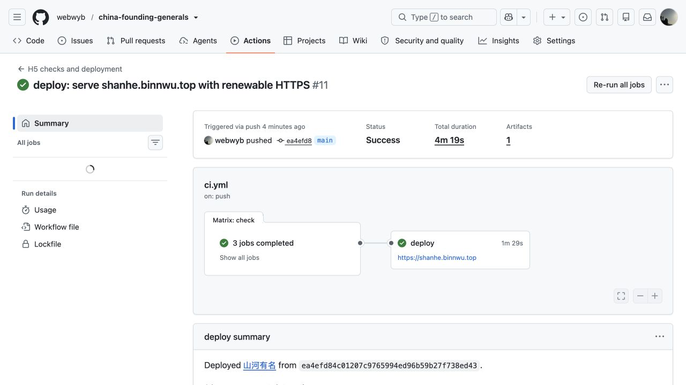
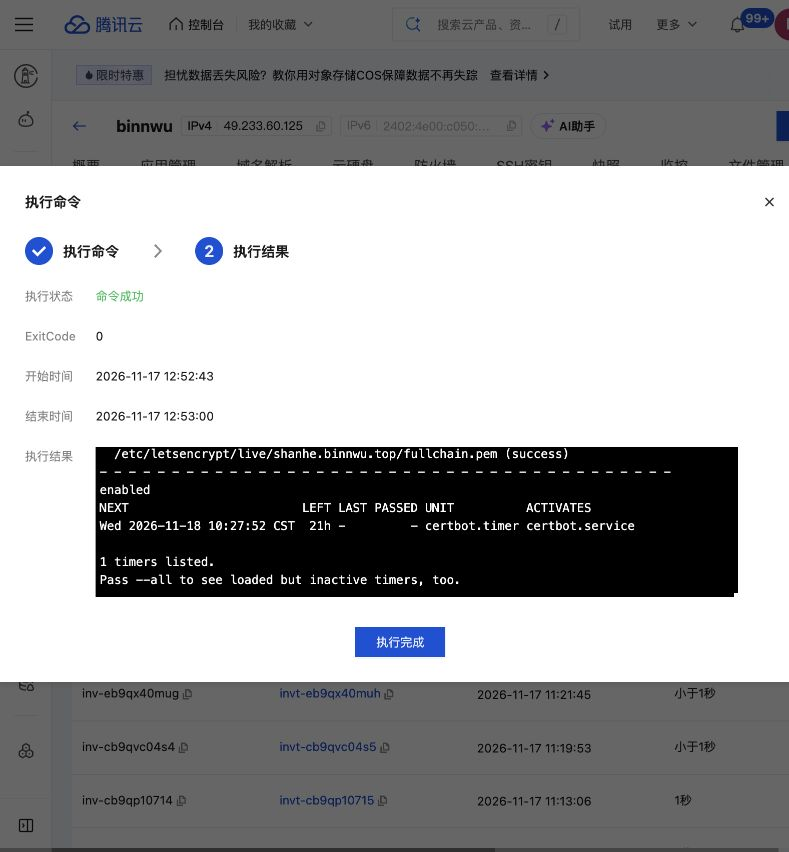

# 新域名与 HTTPS 接入验收

接入日期：2026-11-17（UTC+8）。正式地址：[https://shanhe.binnwu.top](https://shanhe.binnwu.top)。部署提交 `ea4efd84c01207c9765994ed96b59b27f738ed43`，成功运行：[Actions #11](https://github.com/webwyb/china-founding-generals/actions/runs/44020443262)，总耗时4分19秒，其中部署1分29秒。

本记录归档域名接入时已经完成的操作和实际观察。截图对应接入当时的页面；后续网页提交、素材数量及证书日期以当前版本与实时检查结果为准。维护命令统一见 [部署说明](../../DEPLOYMENT.md)。

| 验收项 | 实际结果 | 证据 |
| --- | --- | --- |
| DNS | DNSPod `binnwu.top` 下 `shanhe` A 记录指向 `49.233.60.125`，默认线路、TTL 600；权威 DNS 与递归 DNS 返回正确地址 | [dns.jpg](dns.jpg) |
| TLS | 公网 HTTPS 200，TLSv1.3、CN `shanhe.binnwu.top`、签发者 Let's Encrypt YE1，`SSL certificate verify ok` | 接入时公网 `curl -Iv` 输出；复核命令见部署说明 |
| 首张证书 | 有效期2026-11-17至2027-02-15，私钥留在服务器 | 服务器 Certbot 成功签发输出；当前日期用 `openssl x509` 检查 |
| HTTP 跳转 | 域名 HTTP 返回308与对应 HTTPS `Location`；HTTP-01 验证路径单独保留 | 接入时公网 HTTP 响应与仓库 `nginx-domain.conf` |
| 自动续期 | `certbot renew --dry-run --run-deploy-hooks --no-random-sleep-on-renew` 成功，Nginx 检查与重载通过；`certbot.timer` 为 enabled 并有下一次计划 | [certificate.jpg](certificate.jpg) |
| 自动发布 | Ubuntu、macOS、Windows 完整检查与 deploy 全部成功，发布日志校验新 HTTPS 地址的 SHA／运行ID／重试编号 | [actions.jpg](actions.jpg)、上述运行链接 |
| 素材增量与 CORS | 此次发布 `0 uploaded; 1375 reused`；素材响应为200，Allow-Origin 为 `https://shanhe.binnwu.top`，GET/HEAD、immutable 缓存与 Vary 保持 | Actions deploy 日志、接入时公开肖像 HEAD 响应 |
| 首页 | 内置浏览器通过正常域名打开，16张图片全部加载，字体状态 loaded；页面图片使用 COS 内容地址 | [home.jpg](home.jpg) |
| 人物与卡片 | 从首页进入粟裕档案，再生成家乡山河与素笺肖像，均为1200×1800 PNG；复制人物链接后出现成功提示 | [card.jpg](card.jpg)、接入时页面观察 |

DNS 刚创建时，本机及浏览器曾命中旧的负缓存；等待正常解析生效后，在同一内置浏览器打开同一域名成功。未修改浏览器证书校验或系统 DNS 配置。

本次接入的页面范围为桌面内置浏览器。未新增 PNG 下载落盘、移动设备、微信或其他桌面引擎验收；此前各项实际结果继续保留在 [QA.md](../../../QA.md)。本次文档归档使用上述已有证据，没有把归档过程记为新一轮浏览器实测。

文档归档提交前，完整 `npm run check`（含1609张肖像和H5构建）、六份文档本地链接与代码围栏、`git diff --check` 及五张 JPEG 解码检查通过。

