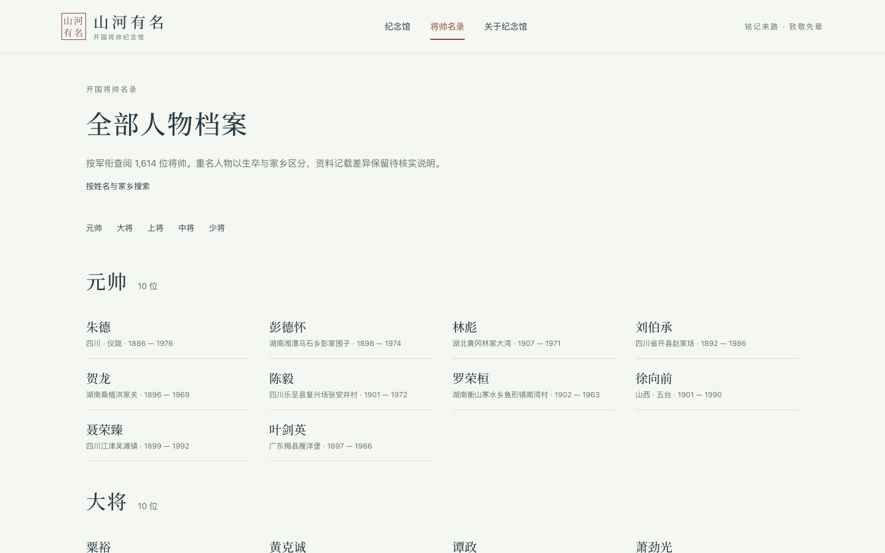

# SEO与路由验收

日期：2026-11-17。范围：本地H5生产构建、原始HTTP、桌面Codex内置浏览器及离线发布包。

## 交付行为

1614位人物拥有独立 `/people/人物id/` 地址。初始HTML复用实际React人物页，直接包含完整分段生平、时间轴、背景、资料差异和出处，不需要执行应用脚本才能读取。首页、名录、完整索引与说明也生成HTML；总计1619个HTML，约38MiB。`robots.txt` 指向1618条规范网址的站点地图，纪念卡入口为noindex，不收录筛选参数和hash路径。

独立标题、描述、canonical、Open Graph、Twitter摘要、WebPage／Person及面包屑结构化数据在初始响应和应用导航中同步。姓名相同的人物保留独立ID与区分标题；未确定的事实不补成定值，缺肖像不把占位图写入人物结构化数据。旧人物与纪念卡hash链接通过浏览器迁移；新的分享链接及二维码使用普通路径。

完整索引沿用瓷白、黛墨、朱砂和本地宋体，按军衔展示姓名、家乡与生卒。共用Button增加真实href分支，普通点击继续应用导航，修饰键保留原生链接行为。没有另建人物正文或卡片绘图实现。

## 自动与HTTP检查

| 检查 | 实际结果 |
| --- | --- |
| `npm run check` | 退出码0，原有检查、卡片解码、H5构建及SEO校验通过 |
| 全量初始HTML | 1614人完整段落／时间轴／背景／引用，1614个独立标题，1618条站点地图地址通过 |
| 元信息与资源 | 单一title、description、canonical及JSON-LD；图片与本地CSS／JS路径可解析；缺图及待核实状态保留 |
| `npm run validate:seo:http` | 9个入口HTTP200并返回对应构建原文，普通与爬虫标签内容一致；未知人物404 |
| 发布接收器回归 | 4项通过，包括限定SEO文件、越界拒绝、原子发布与回滚 |
| 资源回归 | 2项通过，包括嵌套HTML、本域绝对分享图、相对CSS／JS地址重写及其他网站URL保留 |
| `npm run validate:seo:release` | 临时副本模拟COS重写，1609个分享图地址匹配清单；实际代码包1614份人物HTML安全解包通过，4054514字节 |
| 实际浏览器生成卡片 | 李贞1200×1800 PNG独立解码为 `https://shanhe.binnwu.top/people/lizhen/` |
| 本地宋体 | 索引与说明页所用中文均包含在现有WOFF2子集中 |

可复查报告：[全量SEO](../../../data/testing/seo.json)、[原始HTTP](../../../data/testing/seo-http-2026-11-17.json)、[离线发布包](../../../data/testing/seo-release-2026-11-17.json)、[实际卡片解码](../../../data/testing/seo-card-link-2026-11-17.json)、[原始浏览器读数](browser-observations.json)。HTTP检查不执行JavaScript，也不表示真实Googlebot已访问；发布包检查不连接云端或生产服务器。

## 浏览器复核

仅使用桌面Codex内置浏览器访问 `http://127.0.0.1:5173`。实际CSS视口为320×812、405×852及1440×900，临时覆盖已恢复。

- 旧朱德纪念卡hash迁移到新工具地址，noindex及人物canonical正确，返回朱德档案后恢复可索引状态。
- 从朱德切换刘伯承、直接刷新人物地址、回名录搜索李贞、进入人物和纪念卡，URL与元信息跟随当前人物。
- 从完整索引进入于权伸，保留籍贯／地域待核实及不推测配景的状态。
- 完整索引实际有1614个人物链接、0个可执行应用脚本；说明页也可独立阅读。320px正文／页脚、1440px索引查看通过。
- 返回首页后canonical、标题和摘要恢复；旧粟裕hash直达新的粟裕人物页。

转场中的原始DOM读数曾出现横向溢出；再次查看过渡结束状态，当前页x=0、宽405px、无横向溢出。缓存的Taro页为display:none，因此原始DOM统计可能有多个h1；实际初始HTML独立校验为一个h1，浏览器当前可访问树只展示当前页面。原始读数保留这些中间状态，未删成全绿记录。

浏览器复核后仅将说明页“生成人脸”改为现有宋体已覆盖的“生成肖像”，并以 `URLSearchParams.toString()` 避免依赖较新的size属性；最终完整构建及检查通过。截图保留实际拍摄时的文案，不冒充再次截图。

代表截图：[桌面索引](directory-desktop.jpg)、[320px索引](directory-320.jpg)、[320px说明与页脚](about-footer-320.jpg)、[朱德档案](zhude-person.jpg)、[旧链接直达粟裕](suyu-320.jpg)。[李贞卡片原PNG](lizhen-card.png)用于独立解码。

## 发布边界

本轮没有提交或推送，没有更新生产接收器、部署上线、验证站长平台或提交站点地图，也没有真机／其他引擎与实际搜索收录检查。首次上线前必须按 [部署说明](../../DEPLOYMENT.md#seo静态页面的首次发布) 更新root持有的接收器；现有Nginx目录索引与真实404规则可继续使用。源码、构建、自动报告和浏览器证据不能代替公开网站与搜索引擎的实际结果。

维护与实现依据见 [SEO维护](../../SEO.md)。

